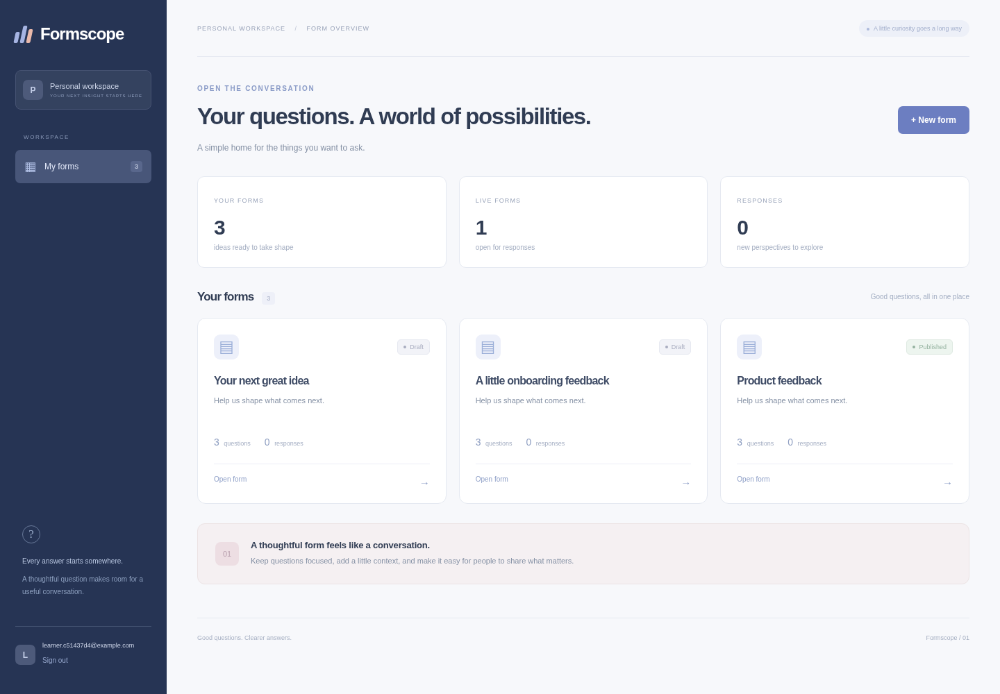
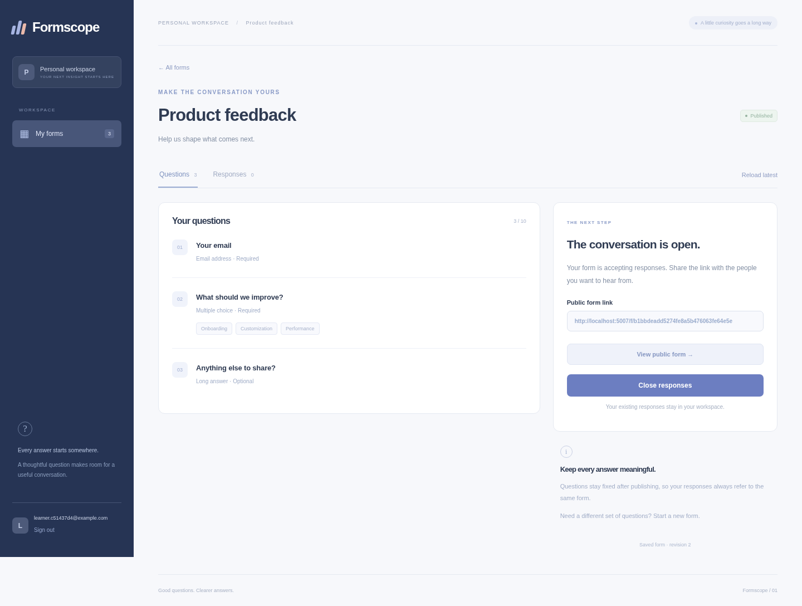
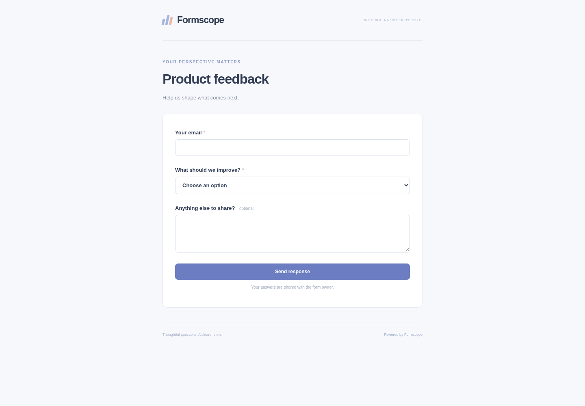
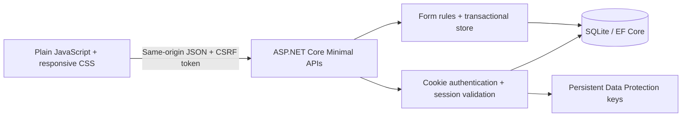

# Formscope

**Ask better. Learn more.** A form-building workspace built with **C#, ASP.NET Core 10, Entity Framework Core and SQLite**, with a plain JavaScript frontend.

Create a draft, add focused questions, publish a public link, and collect validated responses in a private workspace. Questions become fixed after publication, so existing answers always refer to the same form.



## Features

- Private accounts and independent form workspaces.
- Build drafts with long-answer, email and multiple-choice questions.
- Set questions as required or optional.
- Publish forms, close responses and reopen the same form.
- Share a public link that respondents can use without an account.
- View the latest 100 responses privately, alongside the total response count.
- Validate answers against the published schema and deduplicate retried submissions.
- Reject stale form changes with optimistic version checks.

## Run locally

Requires **.NET 10 SDK**. Tested with SDK **10.0.404** and runtime **10.0.15**. Node.js is only needed for browser tests and formatting.

```sh
dotnet restore server/Formscope.csproj --locked-mode
DOTNET_ENVIRONMENT=Development dotnet run --project server --no-launch-profile --urls http://localhost:5007
```

Open **http://localhost:5007** and create an account. No demo credentials or seed data are included. The frontend needs no build step and calls no external font, analytics or form service.

The `Development` environment allows local HTTP cookies. The default `Production` environment requires HTTPS for session and antiforgery cookies.

SQLite and ASP.NET Data Protection keys live in the application's `var` directory. You can choose an absolute path with the `DataPath` environment variable. Keep the database and keys private and persistent; losing the keys invalidates existing authentication/antiforgery cookies.

## The form lifecycle

| State | Questions | Public submissions |
| --- | --- | --- |
| Draft | Add/remove questions; editable through the API | Not available |
| Published | Fixed | Open |
| Closed | Fixed | Closed; existing responses remain private and available |

Publication requires at least one question. A published or closed form cannot return to draft. Reopening uses the same questions and public URL. Start a new form when you need a different questionnaire.

The UI sets title/description when creating the form and supports adding/removing draft questions. The draft-replacement API can also update title, description and question definitions before publication.



## Validation and submission integrity

A form supports up to **10 questions**. Choice questions require **2–8 distinct options**. Labels, options, descriptions and answers have server-side limits; email and choice answers are validated by type. Unknown question IDs and unknown JSON properties are rejected.

Each submission has a UUID request ID. The server normalizes the UUID and answer values, validates against the fixed schema, and records a fingerprint. Retrying the same request with the same answers returns the original receipt. Reusing its ID with different answers returns 409. A new submission to a closed form returns 410; replaying an already accepted receipt remains safe after closure.

This does not restrict respondents to one answer per person. A deliberate submission with a new request ID is a new response. The browser preserves its request ID while retrying within the page; reloading starts a new submission attempt.



## Architecture



- `server/Domain/FormRules.cs`: schema validation, answer validation, state rules and canonical fingerprints.
- `server/Domain/FormStore.cs`: ownership checks, transactional publication/submission and version-guarded updates.
- `server/Program.cs`: HTTP routes, cookie authentication, antiforgery, rate limits and static hosting.
- `server/wwwroot`: dependency-free frontend with escaped text rendering and a restrictive content security policy.

See [architecture decisions](docs/architecture.md) and [HTTP API documentation](docs/api.md).

## Validation

```sh
dotnet restore tests/Formscope.Tests/Formscope.Tests.csproj --locked-mode
dotnet test tests/Formscope.Tests/Formscope.Tests.csproj --no-restore
dotnet build server/Formscope.csproj --no-restore
npm ci
npx playwright install chromium --only-shell
npm run test:e2e
```

The browser suite starts its own server on port **5007**, uses `server/var/e2e` and runs against Chromium. Keep the port free. It covers building and publishing a form, anonymous submission, private responses, closing/reopening, CSRF rejection, ownership isolation, duplicate submissions, escaped untrusted text and mobile overflow.

The xUnit suite covers schema boundaries, malformed question definitions, required/optional answers, email/choice validation, state transitions, fixed published schemas, UUID normalization, conflicting retries, closed-form behavior, database reopening and concurrent version conflicts. GitHub Actions runs the build and both suites.

`PLAYWRIGHT_EXTERNAL_SERVER=1` uses an already-running development server; it creates test accounts/forms in that server's configured database. `PLAYWRIGHT_CHROMIUM_PATH` selects an existing Chromium executable. Screenshot fixtures contain fictional form content.

## Configuration and hosting

| Setting | Purpose |
| --- | --- |
| `DataPath` | Absolute path for SQLite and Data Protection keys; default `var` |
| `DOTNET_ENVIRONMENT` | `Development` for local HTTP; `Production` for public HTTPS |
| `ASPNETCORE_URLS` | Listener URLs, or use `--urls` |

Authentication uses ASP.NET's PBKDF2 password hasher, encrypted HttpOnly/SameSite=Strict cookies and server-side session records. Sessions expire after 12 hours, have no sliding renewal, and are revoked on logout. Only SHA-256 session-token digests are stored in SQLite.

Unsafe API requests require the antiforgery token returned by `/api/session` and its matching cookie. JSON bodies are capped at 64 KiB. Authentication is limited to 20 requests per direct IP per 15 minutes; public submission to 30 per minute. These rate limits are process-local.

A [Docker example](docs/docker.md) is included. The native .NET build and browser flow were exercised; the Docker image has not been built in this environment. For public hosting, configure HTTPS and persistent data, or an explicitly trusted TLS proxy policy, before using the Production environment. No forwarded-header trust override is included.

The repository publishes source and run instructions, not a hosted demo. Back up SQLite with its backup API or stop the application before copying the database and WAL files together; preserve the key directory alongside it.

## Scope and tradeoffs

There are no file uploads, multi-page forms, conditional questions, custom domains, response exports, respondent accounts, email notifications, spam detection, team roles, password reset or email verification. Existing forms/responses cannot be deleted through this release's UI.

Questions are not editable after publication; form duplication and schema version history are not included. Responses are stored in the application's database and visible only to the form owner. Public form links do not expose the owner's email or response data.

SQLite and in-process throttling suit a small single-instance installation. The project uses EF Core `EnsureCreated` for fresh databases and does not include versioned migrations. Introduce migrations before changing a deployed schema; multi-instance hosting also needs shared session/rate-limit/key storage and a server database.

## License

[MIT](LICENSE)
